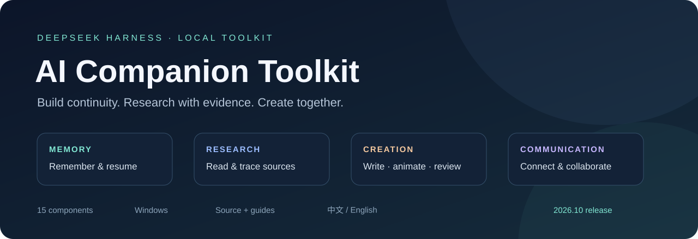

# AI Companion Toolkit

[中文](README.md) | English

A collection of local plugins for DeepSeek Harness: memory and context continuity, creative and video workbenches, desktop control, research reading, QQ communication, and adapted versions of existing community plugins.

This is a **Windows / DeepSeek Harness (rc.3 baseline with locally checked rc.5 adaptations) source snapshot**, not a universal installer. Some modules depend on the desktop SDK layout and separately configured runtimes.

**2026-10-31 update:** stronger memory persistence, evidence history and recovery; explicit video acquisition/coverage receipts and local evidence pagination; a shared GPU-first ASR runtime with CPU fallback. The same **15 components** gain these features through existing entry points. Read the [update and examples](docs/UPDATE-20261031.en.md).

## Start with your goal

| I want my assistant to… | Start here |
|---|---|
| Remember agreements and resume work later | [Memory and continuity](harness-plugins/扩展/lian-continuity/GUIDE.en.md) · [Tool navigation](harness-plugins/扩展/lian-extension-bridge/GUIDE.en.md) |
| Research webpages, PDFs and videos | [Research reader](harness-plugins/扩展/lian-research-reader/GUIDE.en.md) · [Bilibili](harness-plugins/扩展/bili-perception/GUIDE.en.md) |
| Turn a draft into a code-based video | [Creative methods](harness-plugins/扩展/lian-creation-handbooks/GUIDE.en.md) · [Creative workbench](harness-plugins/扩展/lian-creative-workbench/GUIDE.en.md) · [Video studio](harness-plugins/扩展/lian-video-studio/GUIDE.en.md) |
| Use QQ or collaborate with another assistant | [QQ bridge](harness-plugins/扩展/dsh-qq-bridge/GUIDE.en.md) · [Harness–Codex liaison](harness-plugins/扩展/lian-codex-liaison/GUIDE.en.md) |
| Organize files, windows and study activities | [Workspaces](harness-plugins/扩展/lian-workspace-manager/GUIDE.en.md) · [Desktop control](harness-plugins/扩展/lian-desktop-control/GUIDE.en.md) · [Study and budget](harness-plugins/dafeiyu-life/GUIDE.en.md) |

## Plugin catalog

| Component | Version | Purpose |
| --- | --- | --- |
| [Autonomous learning and budget management](harness-plugins/dafeiyu-life/GUIDE.en.md) | 1.4.7-lian.1 | Lets the assistant study during configured hours and manage an activity budget: for example, research a topic, save source cards, reserve estimated cost before an integrated model call and settle it afterward. |
| [External tool connection configuration](harness-plugins/dafeiyu-toolbox/GUIDE.en.md) | 1.0.2 | Connects the assistant to external tools such as a browser and video processors. MCP is a protocol for calling external tools; this component mainly supplies connection configuration, not the external applications themselves. |
| [Memory, tasks and context continuity](harness-plugins/扩展/lian-continuity/GUIDE.en.md) | 1.5.2 | Store memory, task and artifact versions; detect file changes and uncertain delivery; connect video shots, version-bound feedback and recorded costs for reliable continuation. |
| [Extension status and memory service bridge](harness-plugins/扩展/lian-extension-bridge/GUIDE.en.md) | 1.2.0 | Find relevant tools and small examples from a goal, inspect real registrations and connect separately configured local memory services such as ReMe. |
| [Harness–Codex liaison](harness-plugins/扩展/lian-codex-liaison/GUIDE.en.md) | 1.6.0 | Exchange messages between Harness and an independent Codex session; correlate normal final replies with messages and turns, retain receipts and check the permitted communication window. |
| [Video production and exported-film review](harness-plugins/扩展/lian-video-studio/GUIDE.en.md) | 1.5.3-lian.1 | Creates, previews and exports code-based videos and helps inspect the exported file. It can sample a video into a timestamped image grid and retrieve the original frame for a selected cell. |
| [Creative workbench](harness-plugins/扩展/lian-creative-workbench/GUIDE.en.md) | 1.4.1 | Brings writing, code animation, 3D, design and voice tools into a common workbench so an assistant can move from an idea to the appropriate tool. |
| [Creative methods library](harness-plugins/扩展/lian-creation-handbooks/GUIDE.en.md) | 4.7.0 | Read story, dialogue, visual and directing methods by topic; adds scene revision and sharing real activities. |
| [Windows desktop observation and control](harness-plugins/扩展/lian-desktop-control/GUIDE.en.md) | 1.5.0 | Lets the assistant list and observe Windows windows via screenshots and, when authorized, operate the mouse and keyboard. It also supports short recordings and audio/video capture. |
| [Web and document reader](harness-plugins/扩展/lian-research-reader/GUIDE.en.md) | 1.0.1 | Helps the assistant read public webpages, PDFs and image material while retaining traceable sources, useful for research or checking a document. |
| [Bilibili perception and operation adapter](harness-plugins/扩展/bili-perception/GUIDE.en.md) | 1.5.0 | Helps analyze Bilibili videos using available subtitles, sampled frames, text recognition and comments, with time-range selection for focused review. |
| [Improved sidebar](harness-plugins/扩展/dsh-better-sidebar/GUIDE.en.md) | 0.28.0-lian.1 | Adds a file sidebar to Harness for browsing, searching and editing workspace files; this modified version also retains recovery records for deletions and overwrites. |
| [Improved QQ bridge](harness-plugins/扩展/dsh-qq-bridge/GUIDE.en.md) | 0.6.2-lian.2 | Connects a Harness assistant to QQ through a separately logged-in QQ backend, supporting private/group messages and configured voice and delivery receipts. |
| [Local workspace manager](harness-plugins/扩展/lian-workspace-manager/GUIDE.en.md) | 1.1.0 | Manages local assistant workspaces: inspect or switch directories, repair session/workspace association and create backups. |
| [Workspace menu](harness-plugins/扩展/lian-workspace-menu/GUIDE.en.md) | 1.2.0 | Adds workspace entry points and a directory-switching menu to the Harness interface, helping users select the directory used by the current chat. |

## Upstream sources and local changes

The sidebar, QQ bridge and parts of Bilibili integration use third-party MIT projects or code; the video overview references an upstream design. See [upstream sources and changes](docs/UPSTREAM.en.md) for each project, reuse scope, local modifications and license.

New to the terminology? See the [beginner’s glossary](docs/GLOSSARY.en.md).

## Getting started

1. Read [Installation](docs/INSTALL.en.md) and generate a separate local configuration copy.
2. Select required components with [Dependencies and runtimes](docs/DEPENDENCIES.en.md).
3. Follow [Usage](docs/USAGE.en.md) and each component guide; use the schemas exposed by the actual host.
4. Review [Configuration and privacy](docs/PRIVACY.en.md), [Known limitations](docs/LIMITATIONS.en.md) and [Third-party notices](THIRD_PARTY_NOTICES.md).

## Layout

- harness-plugins/: source and runtime adapters; retain relative directory relationships.
- harness-plugins/扩展/: Harness extension packages.
- docs/: installation, usage, dependencies and scope.
- tools/: local configuration and file-integrity utilities.
- catalog.json: versions of 15 components.
- SHA256SUMS.json: integrity manifest.
